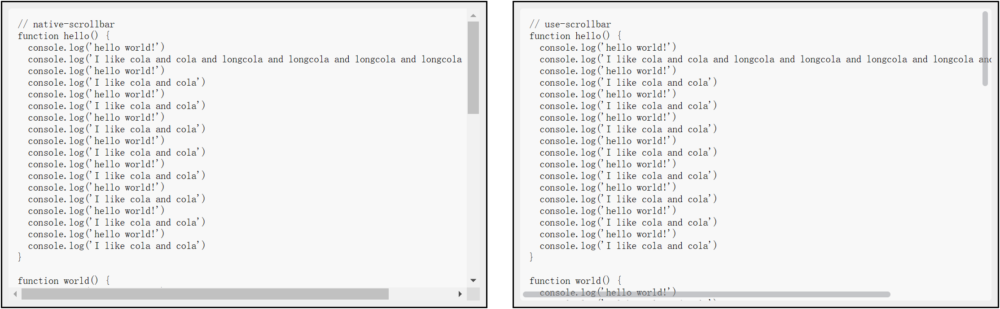
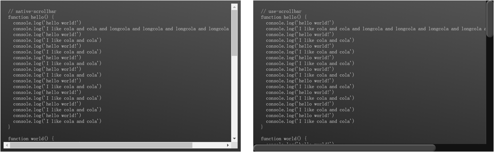

<p align="center">
  
</p>

<p align="center">
  <!-- npm version -->
  <a href="https://www.npmjs.com/package/@lionad/use-scrollbar"></a>
  <!-- ci status -->
  <a href="https://github.com/Lionad-Morotar/use-scrollbar/actions/workflows/ci-on-release.yml"></a>
  <!-- license -->
  <a href="https://github.com/Lionad-Morotar/use-scrollbar/blob/main/LICENSE"></a>
</p>

# use-scrollbar

Replace a component's native scrollbar with a fully customizable virtual scrollbar — built for styling complex third-party widgets like vxe-table and antd-vue-table. Not to be confused with virtual scrolling; this is purely a scrollbar overlay.

**[Live Demos](https://lionad-morotar.github.io/use-scrollbar/)** — vxe-table、antd-vue-table、AG Grid、Tabulator、CodeMirror 6、Element Plus Table

## Features

- **Powerful API** — handles deeply nested scroll containers inside complex components, which wrapping-style scrollbar components can't reach
- **Fully customizable** — create your own scrollbar style, animation and interaction; built-in themes: `normal`、`steam`、`css-tricks`
- **Full typed** — complete TypeScript declarations
- **SSR safe** — DOM access is guarded and silently skipped on the server
- **Performance-conscious** — frame-batched drag updates, frequency-layered style writes, debounced scroll-state detection
- Vue 3 only (`vue ^3.5`)

## Preview

<h4>1. Native Scrollbar <strong>VS</strong> Customized Scrollbar (theme: default)</h4>

<p align="center">
  
</p>

<h4>2. Native Scrollbar <strong>VS</strong> Customized Scrollbar (theme: css-tricks)</h4>

<p align="center">
  
</p>

## Quick Start

### Vue

```bash
pnpm add @lionad/use-scrollbar
```

```typescript
import { useScrollbar } from '@lionad/use-scrollbar'
import { ref } from 'vue'

// dont forget to import style.css
// in your main.ts (or entry.ts anyway)
import '@lionad/use-scrollbar/dist/style.css'

const componentOrElementRef = ref(null)
const barStates = useScrollbar(componentOrElementRef, {
  // override default options
})
```

### Nuxt

The companion module handles auto-imports and style injection (SSR safe, zero config):

```bash
pnpm add @lionad/use-scrollbar @lionad/use-scrollbar-nuxt
```

```typescript
// nuxt.config.ts
export default defineNuxtConfig({
  modules: ['@lionad/use-scrollbar-nuxt'],
  // 需要完全自管样式时可关闭注入
  // useScrollbar: { injectStyles: false },
})
```

## Packages

| 包 | 说明 |
| --- | --- |
| [`@lionad/use-scrollbar`](./packages/vue) | 核心包：`useScrollbar` 等 composables 与主题样式 |
| [`@lionad/use-scrollbar-nuxt`](./packages/nuxt) | Nuxt 模块：auto-imports + 样式注入 |
| [`playground`](./playground) | 演示场（`pnpm dev` 启动），部署于 GitHub Pages |

## Documentation

详细 API 文档（States / Actions / Hooks）见核心包 [packages/vue/README.md](./packages/vue/README.md)；Nuxt 模块配置项见 [packages/nuxt/README.md](./packages/nuxt/README.md)。

## Development

```bash
pnpm install
pnpm dev
```

## License

MIT License
