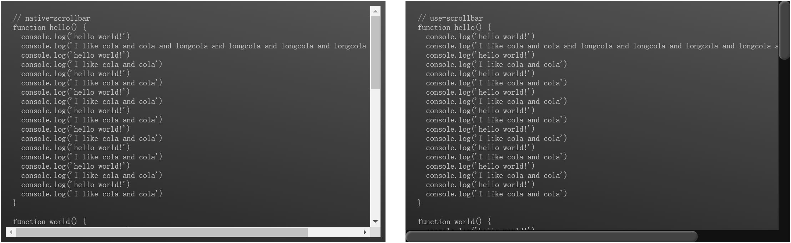

<p align="center">
  
</p>

<p align="center">
  <!-- npm version -->
  <a href="https://www.npmjs.com/package/@lionad/use-scrollbar"></a>
  <!-- license -->
  <a href="https://github.com/Lionad-Morotar/use-scrollbar/blob/main/LICENSE"></a>
</p>

# @lionad/use-scrollbar

`use-scrollbar` replaces a component's native scrollbar with a fully customizable one — ideal for styling third-party widgets like tables. Not to be confused with virtual scrolling; this is purely a scrollbar overlay.

## Features

- **Powerful API**, able to deal with complex components[^1], such as vxe-table、ant-vue-table
- **Customizable**, so that you can create your own scrollbar style, animation and user interaction
- **Theme**, integrated with these style configurations: ElementPlus, Steam, CSS-Tricks ...
- **Full Typed**, with the power of typescript
- **SSR Safe**, DOM access is guarded and silently skipped on the server

[^1]: which is not possible with other libraries

## Preview

<h4>Native Scrollbar <strong>VS</strong> Customized Scrollbar (theme: css-tricks)</h4>

<p align="center">
  
</p>

## Install

```bash
pnpm add @lionad/use-scrollbar
```

Using Nuxt? Try the companion module [`@lionad/use-scrollbar-nuxt`](https://www.npmjs.com/package/@lionad/use-scrollbar-nuxt) for auto-imports and style injection.

## Usage

```typescript
import { useScrollbar } from '@lionad/use-scrollbar'
import { ref } from 'vue'

// dont forget to import style.css
// in your main.ts (or entry.ts anyway)
import '@lionad/use-scrollbar/dist/style.css'

const componentOrElementRef = ref(null)
const barStates = useScrollbar(componentOrElementRef, {
  // override default options
})
```

Live demos (vxe-table, antd-vue-table, AG Grid, Tabulator, CodeMirror 6, Element Plus Table): [playground](https://github.com/Lionad-Morotar/use-scrollbar/tree/main/playground/src)

## Document

### States

#### barStates.theme

改变滚动条样式。

```typescript
const theme = 'normal' // 'normal' | 'steam' | 'css-tricks'
barStates.theme = theme
```

#### barStates.offset

改变滚动条相对挂载元素的偏移量。

```typescript
barStates.offset.y.top = 10 // px
barStates.offset.y.right = 10 // px
barStates.offset.x.left = 5 // px
barStates.offset.x.bottom = 5 // px
```

#### barStates.scrollTop / barStates.scrollLeft

如果传入多个 wrapper，那么 scrollTop 属性等同于这几个 wrapper 对应 DOM 元素的最大的哪个 scrollTop 属性。如果需要滚动 wrapper 中的内容，可以给 scrollTop 设置值，也可以使用 barStates.scrollTo 方法。scrollLeft 类似。

#### barStates.isDragging

判断当前滚动条是否处于拖动状态。

```typescript
console.log(barStates.isDragging.y)
```

#### barStates.isScrolling

获取当前滚动区域的滚动状态。

```typescript
console.log(barStates.isScrolling.x)
```

### Actions

#### barStates.init

如果不是通过显式初始化（即 `useScrollbar(elem)`）的方式自动初始化滚动条，那么需要使用 init 方法手动初始化。init 方法提供了对控制滚动区（甚至多个滚动区）所需要的更细致的参数。

```typescript
const $parent = cmptRef.value.$el.parentElement
const $wrapper = $parent.querySelector('.content-wrapper')
const $content = $parent.querySelector('.content')

// 详细 API 见类型文档
barStates.init({
  mount: cmptRef.value,
  content: [$content],
  // 可以不传，默认为 content 的上一级父元素
  wrapper: [$wrapper],
  // 可以不传，默认为 wrapper 或 wrapper 的第一个元素
  viewport: $wrapper,
})
```

#### barStates.visibleOnHover

监听传入元素的鼠标事件，mouseenter 时显示滚动条，mouseleave 时隐藏滚动条。

#### barStates.setOffset

根据传入元素的尺寸自动设置滚动条的偏移量。典型场景：弹窗内容区填充了 `position:sticky` 头部，y 轴滚动条的上方偏移量应为头部高度——传入头部元素即可动态跟踪。

```typescript
const cmptOrElemRef = ref(null)

barStates.setOffset({
  y: {
    top: cmptOrElemRef,
  },
})
```

### Hooks

#### useScrollbar

等同于 useScrollbars，用于将一个已有的滚动系统的原生滚动条替换为虚拟滚动条，也是这个库最主要的功能。

#### useNativeScrollbar

获取原生滚动条相关的一些信息，如宽度。

```typescript
const nativeBar = useNativeScrollbar()

console.log(nativeBar.thick) // usually 17px in Windows
```

## License

MIT License
